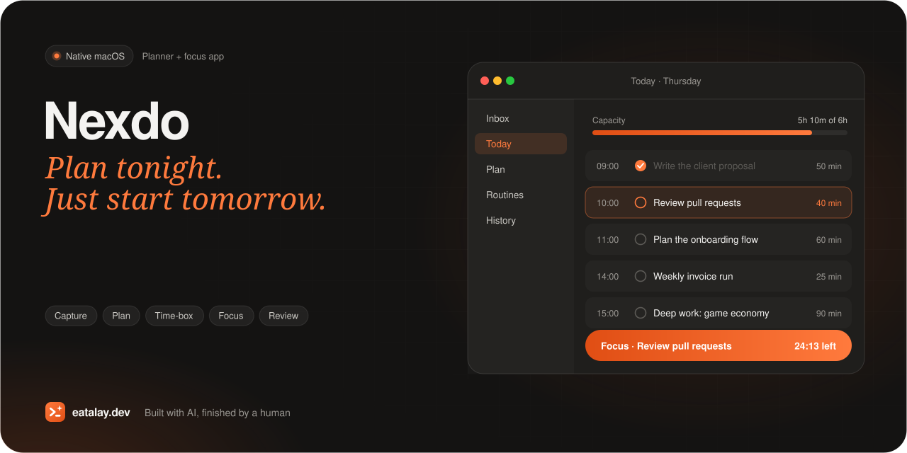

**Nexdo is not another to-do list.** The hard part is rarely storing tasks; it's deciding what to do, starting it and finishing it. Nexdo splits the day into two modes. In the evening you make every decision: what matters, in what order, for how long, and what the first physical step is. The next day you don't decide anything. You press start and work through the plan.

> Native macOS, written in Swift with SwiftUI and SwiftData. The interface is in Turkish.

## The loop

**Capture → Decide → Plan → Time-box → Start → Focus → Finish or stop → Review**

- **Inbox and quick capture.** A global keyboard shortcut opens a capture panel from anywhere, so nothing waits in your head.
- **Evening planning.** Triage the inbox with an Eisenhower view, pick tomorrow's tasks, order them and give each a time box and a first action.
- **Honest capacity.** Available time minus routines, planned tasks and a buffer. The capacity bar tells you when the plan no longer fits the day.
- **Today and focus mode.** One task at a time with a live countdown. When the box ends: *Done*, *Stopped here* or *+15 minutes*. Actual time is recorded next to the estimate.
- **Postponing is data.** Can't start? Pick a reason (no energy, too big, unclear next step, something came up, wrong environment) instead of silently moving the task.
- **Routines** that repeat on chosen weekdays and count against capacity.
- **Menu bar** popover with the current task and timer, plus notifications and launch at login.
- **History and day review** to compare plans with what actually happened.

## Under the hood

```
Nexdo/
├── App/            entry point, environment, appearance
├── Domain/         TaskItem, DailyPlan, FocusSession, Routine, Postponement, Project + enums
├── Persistence/    SwiftData repositories
├── Services/       CapacityService, PlanningService, FocusSessionEngine, FocusTimerService,
│                   RoutineScheduler, StatisticsService, NotificationService, GlobalShortcutCenter
├── Features/       Inbox, Planning, Today, Focus, Routines, History, MenuBar, QuickCapture, Settings
└── DesignSystem/   surfaces, layout, materials and typography
NexdoTests/         capacity, planning, focus engine, routines, statistics, Today view model
```

The rules live in services, not views, and the services are covered by unit tests. The focus timer is a small state machine that survives app restarts.

## How it was built

The product spec in [`AGENT.md`](AGENT.md) (Turkish, 45 sections from data model to accessibility) is the brief an AI agent team builds from. I own the product decisions and review every change before it lands.

## Run it

Requires Xcode with the macOS 27 SDK. Open `Nexdo.xcodeproj`, select the **Nexdo** scheme and press ⌘R.

---

<sub>Made by **Emrah Atalay** at <a href="https://eatalay.dev/en">eatalay.dev</a>: mobile apps, games and automation, built with AI and finished by a human. Need an app like this? <a href="mailto:info@eatalay.dev">info@eatalay.dev</a></sub>
